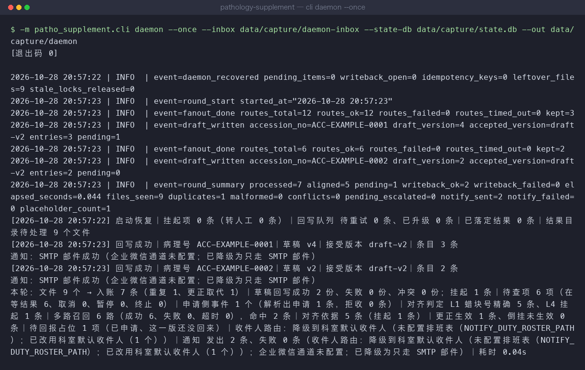
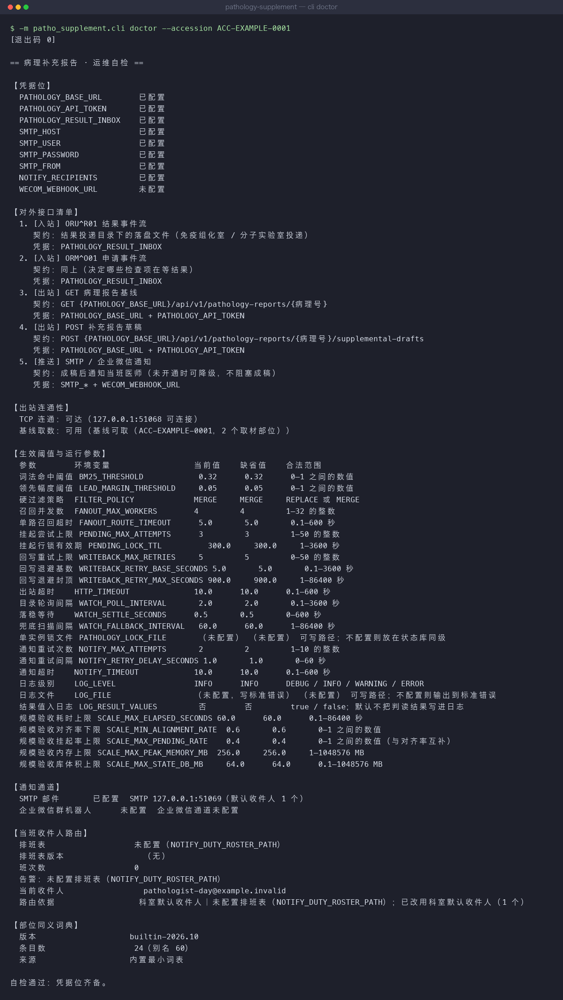
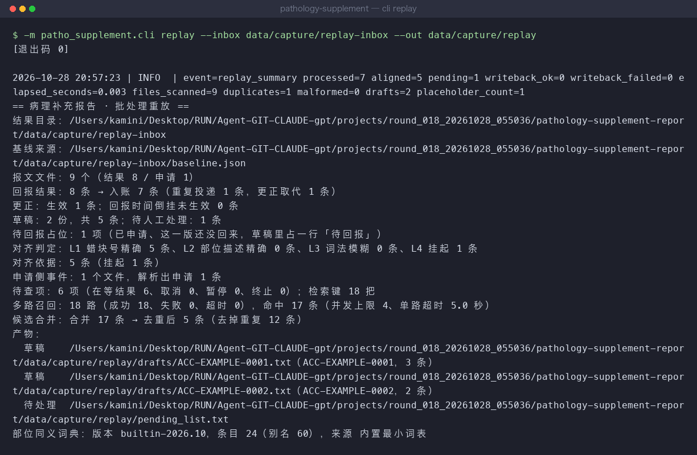
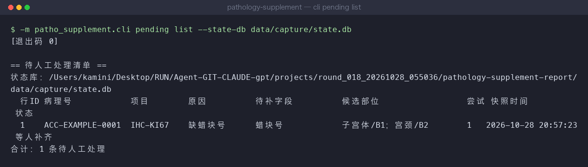
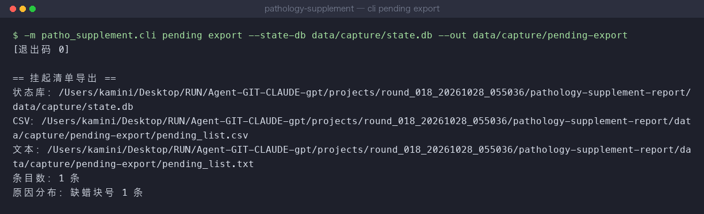
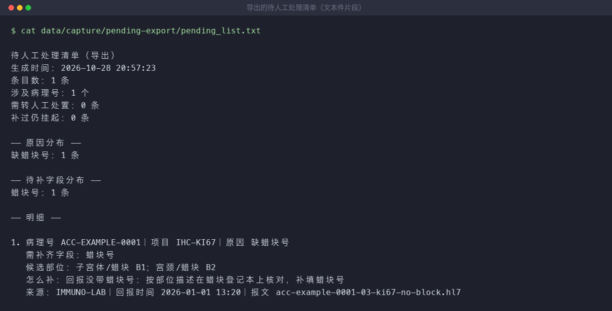
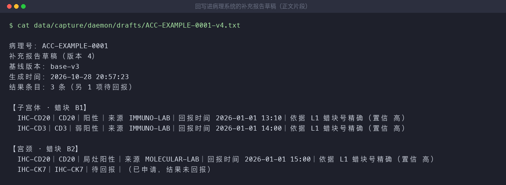
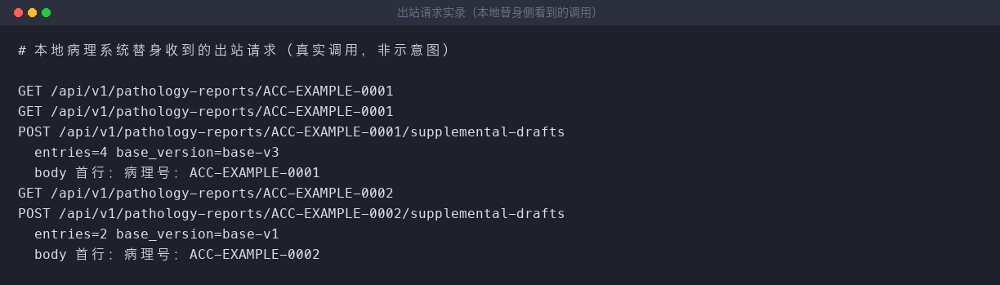

# 病理补充报告生成系统

> 免疫组化室与分子实验室回报的加做检查结果投进结果目录，系统自动把每条结果对回取材部位与蜡块号，约一分钟内回写出一份**按取材部位分组、逐项标明来源与回报时间**的补充报告草稿；对不上的那几条单独列出来，写清缺哪个字段、候选是谁，等人补齐后接着跑。

病理科日常最耗人的一段活，是「结果回来了，报告还差一截」：免疫组化、分子检测的回报分散在几个来源里，
要人工翻出来、人工对回部位与蜡块号、人工誊进补充报告，还要单独记下哪些项还没到。
本系统接管这段活——**结果投进目录 → 病理系统草稿区出现补充报告草稿 + 一份待人工处理清单**。
草稿只写到草稿区，签发仍在院内系统里由医师完成；本系统不产出判读结论，也不代签。

## 适用场景 / 目标岗位

| 岗位 | 什么时候用 | 得到什么 |
|------|------------|----------|
| 病理科初检 / 复检医师 | 一批加做结果回报后要写补充报告时 | 一份按取材部位分组、逐项标明来源与回报时间的草稿，已放进病理系统草稿区，只差签发 |
| 病理科技术员 | 蜡块号或部位描述登记有误，结果对不上部位时 | 一份待处理清单：哪条结果没对上、缺哪个字段、可能是哪几个部位、该查哪张登记 |
| 免疫组化室 / 分子实验室 | 加做结果回报、落盘投递时 | 回报条目自动归位到部位与蜡块，不必再手工誊进报告 |
| 信息科 | 对接地址变更、接口不可达、需要排查时 | 一条自检命令看清 5 条对外接口通不通、哪个凭据位没配 |

## 能力要点

- **把结果对回部位和蜡块号**：归属键是「病理号 + 部位序号 + 蜡块号」，先按蜡块号精确对，再按部位描述对；
  两者都对不上就停下来等人补，不猜。医师拿到草稿时，每一行都能追到来源系统与回报时间。
- **对不上的结果绝不硬塞进草稿**：缺蜡块号、部位描述缺失、同一个部位出现两个候选，一律挂起，
  清单里写明缺哪个字段、候选是谁 —— 少写一条是问题，写错一条是事故。
  已申请但还没回来的项占一行「待回报」；回报过但写不进报告的（无法获得、值为空、归属对不上）
  留在待人工处理清单里，不会被写成「还没回来」，也不会在报告里留一行空项。
- **重复投递不会把报告写重**：同一批结果重复投一次，条目数不变；更正结果取代旧值并留一条审计记录，
  不是追加成第二条。更正的回报时间比已有结果还早时**不取代** —— 较新的原值留着，更正扣下来等人确认。
- **草稿只写到草稿区，签发仍在院内系统**：本系统不产出判读结论、不代签、不自动签名；
  回写遇到版本冲突时停手保留本地草稿，交给人处理，不覆盖别人的版本。
- **病理系统临时不可达也不丢成果**：回写失败的草稿进重试队列，按间隔递增重试；超过次数就升级提醒，
  草稿状态不推进，人工处置后接着走。版本号接着基线往下排（基线是第 3 版，补充报告就是第 4 版），
  旧版本只追加不覆盖，按版本号随时回查。
- **通知按排班表发给当班的人，补齐之后从挂起的那一步接着跑**：照科室自己的排班表找到当前当班医师，只发给他；
  排班表没配、过期或当前时段没排班，就降级到科室默认收件人并在运行摘要里写明降级 ——
  发给全科室等于没人负责。补齐只交「挂起行 ID + 缺失字段值」，不整批重跑。

## 快速开始

### 依赖

- Python ≥ 3.10（院内机按 3.11 及以上部署；运行时**零第三方依赖**，只用标准库，院内机无需联网装包）
- 操作系统：Linux / macOS 均可；院内机按 `systemd` 托管为常驻进程

### 安装

```bash
# 1) 取得代码（院内机直接拷贝目录即可，不需要装包）
cd /opt/pathology-supplement-report

# 2) 准备配置：复制样例并按院内实际填写（真实值只落在 .env，不进仓库）
cp .env.example .env
vi .env

# 3) 开发/自检时安装测试依赖（运行守护进程本身不需要）
python3 -m pip install -r requirements.txt
```

### 配置

配置只有两处来源：**环境变量**优先，`.env` 文件补充；两者都没有就用内置默认值。
凭据（接口令牌、邮箱口令）只从环境变量读，代码里没有任何真实地址、端口或密钥。

| 配置项 | 默认值 | 说明 |
|--------|--------|------|
| `PATHOLOGY_BASE_URL` | 无（必填） | 病理信息系统根地址，不带末尾斜杠 |
| `PATHOLOGY_API_TOKEN` | 无（必填） | 出站 Bearer 令牌，由信息科在病理系统侧签发 |
| `PATHOLOGY_RESULT_INBOX` | 无（必填） | 结果回报投递目录，守护进程只读监听 |
| `PATHOLOGY_STATE_DB` | `data/patho_state.db` | 状态库：挂起项、草稿版本链、回写队列、审计流水 |
| `PATHOLOGY_LEXICON_PATH` | 内置最小词表 | 部位同义词典（外置 JSON，可由科室维护）；文件缺失或格式非法时自动回退内置词表并告警 |
| `SMTP_HOST` / `SMTP_PORT` / `SMTP_USER` / `SMTP_PASSWORD` / `SMTP_FROM` | 无 | SMTP 发信主机、端口、认证账号与口令、发件人；不填则不启用 SMTP 通道 |
| `WECOM_WEBHOOK_URL` | 无 | 企业微信群机器人地址；未配置时自动降级为只走 SMTP |
| `NOTIFY_RECIPIENTS` | 无 | 科室默认收件人（逗号分隔）；排班没命中时用它兜底 |
| `NOTIFY_DUTY_ROSTER_PATH` | 无 | 当班排班表（外置 JSON，科室维护）；命中当前时段就只通知当班医师 |
| `NOTIFY_DUTY_DEPARTMENT` | `病理科` | 科室名；排班表声明了别的科室时装载会告警 |
| `BM25_THRESHOLD` | `0.32` | 部位描述词法得分达到该值才可判为「近似命中」 |
| `LEAD_MARGIN_THRESHOLD` | `0.05` | 最高分需领先次高分该幅度，否则判为歧义并挂起 |
| `FILTER_POLICY` | `MERGE` | `REPLACE`＝硬过滤完全覆盖；`MERGE`＝硬过滤命中 0 条时降级为模糊匹配并标挂起 |
| `FANOUT_MAX_WORKERS` / `FANOUT_ROUTE_TIMEOUT` | `4` / `5` | 多路召回并发数 / 单路召回超时秒数（超时的路单独作废，不拖累其余路） |
| `PENDING_MAX_ATTEMPTS` | `3` | 挂起尝试次数上限：同一条结果反复对不上时，超过该次数转人工处置，不再自动续跑 |
| `WRITEBACK_MAX_RETRIES` | `5` | 回写失败重试上限（间隔递增）；超过该次数升级提醒，草稿状态不推进 |
| `WRITEBACK_RETRY_BASE_SECONDS` / `WRITEBACK_RETRY_MAX_SECONDS` | `5` / `900` | 回写重试的退避基数 / 退避封顶（再往上等也没意义，院内机不能把重试拖到隔天） |
| `HTTP_TIMEOUT` | `10` | 出站 HTTP 超时秒数 |
| `WATCH_POLL_INTERVAL` / `WATCH_SETTLE_SECONDS` | `2` / `0.5` | 结果目录轮询间隔 / 落稳等待秒数（等文件写完再读） |

阈值越界（负数、非数值、超范围）会**直接报错并拒绝启动**，不会悄悄改用默认值 ——
「配错了却看不出来」是院内工具最常见的投诉来源。`cli doctor` 会把上表每一项的
当前生效值、缺省值与合法范围打出来；通知重试、日志、规模验收等其余参数见
[`docs/cli.md`](docs/cli.md)。

### 构建与验证

```bash
# 1) 导入自检：确认三个基础模块可用
python3 -c "import patho_supplement.config, patho_supplement.models, patho_supplement.db"

# 2) 对外接口与凭据位自检（不打印任何凭据值）
python3 -m patho_supplement.cli doctor

# 3) 跑测试
python3 -m pytest -q

# 4) 批处理重放：把结果目录里的回报跑一遍，产出草稿文件与待处理清单
python3 -m patho_supplement.cli replay --inbox tests/fixtures/inbox/ --out ./out
```

### 主命令速查

```bash
# 常驻守护：监听结果目录，事件到达即处理并回写草稿区
python3 -m patho_supplement.cli daemon

# 批处理重放：把目录里的历史回报跑一遍（对账、补跑用）
python3 -m patho_supplement.cli replay --inbox <目录> --out <输出目录>

# 挂起项清单：谁没对上、缺哪个字段、候选是谁
python3 -m patho_supplement.cli pending list

# 补齐一个挂起项并从挂起处续跑
python3 -m patho_supplement.cli pending resolve --id <挂起行ID> --set block_no=B3

# 导出待人工处理清单（CSV + 文本两种）
python3 -m patho_supplement.cli pending export --out ./out

# 基准集跑批 + 三方对照：错绑定 / 误并入 / 挂起率，不达标即非 0 退出（可挂 CI）
python3 -m patho_supplement.cli benchmark --dataset tests/fixtures/benchmark --out reports/benchmark

# 对照实验：对同一批回报，三方（产品 / 仅规范化精确匹配 / 仅取词法最高分）并排比
python3 -m patho_supplement.cli benchmark --inbox tests/fixtures/inbox/ --out reports/benchmark

# 规模与性能验收：一天 300 份报告 / 2000 条回报，量耗时 / 对齐率 / 内存 / 库体积
python3 -m patho_supplement.cli benchmark --inbox tests/fixtures/scale/ --scale-report reports/scale.json

# 运行摘要：这一轮跑了多少（产物目录与状态库两个来源）
python3 -m patho_supplement.cli summary --dir data/replay
```

## 命令 / API / 配置说明

### 关键配置项

配置项全集（默认值与说明）见[快速开始 · 配置](#配置)；下表只补充各配置项的**生效范围与不配置的后果**。

| 配置项 | 生效范围 | 不配置的后果 |
|--------|----------|--------------|
| `PATHOLOGY_BASE_URL` | 出站取基线与回写草稿 | 出站不可用，草稿无法进入病理系统 |
| `PATHOLOGY_API_TOKEN` | 出站 Bearer 认证 | 出站返回 401，草稿只落本地 |
| `PATHOLOGY_RESULT_INBOX` | 守护进程监听目录 | 无入站事件，守护进程空转 |
| `PATHOLOGY_STATE_DB` | 挂起项 / 版本链 / 队列 / 审计 | 落在默认路径 `./data/patho_state.db` |
| `PATHOLOGY_LEXICON_PATH` | 部位同义词典（别名折算到规范词） | 用内置最小词表；词典文件缺失或格式非法时自动回退并告警 |
| `SMTP_*` | 成稿后通知当班医师 | 无邮件通道；若配了企业微信则走企业微信 |
| `WECOM_WEBHOOK_URL` | 通知的备用通道 | 自动降级为只发 SMTP，并在运行摘要中标注降级 |
| `NOTIFY_DUTY_ROSTER_PATH` | 收件人来源：排班表命中就只发当班医师 | 收件人一律走 `NOTIFY_RECIPIENTS`，运行摘要里标注「降级到科室默认收件人」 |
| `PENDING_MAX_ATTEMPTS` | 同一条结果反复对不上时的挂起尝试上限 | 用默认值 `3` 次（超次转人工处置，不再自动续跑） |
| `WATCH_FALLBACK_INTERVAL` | 兜底扫描间隔（结果目录长时间没新文件时强制扫一遍） | 用默认值 `60` 秒（可配，越界拒绝启动） |

### CLI 子命令 / 接口端点

全量参数、默认值与退出码见 [`docs/cli.md`](docs/cli.md)（含每条命令的真实 `--help` 输出）。

| 命令或路径 | 用途 | 关键参数 |
|------------|------|----------|
| `cli daemon` | 常驻运行，监听结果目录并处理 | `--inbox`、`--state-db`、`--out`、`--once`（只跑一轮）、`--cycles`、`--fallback-interval`、`--lock-file`、`--log-level`、`--log-file` |
| `cli replay` | 批处理重放历史回报 | `--inbox`（必填）、`--baseline`、`--out`、`--state-db`、`--lexicon` |
| `cli doctor` | 打印 5 条对外接口、凭据位状态与生效阈值 | `--accession`（指定病理号则真取一次基线，验证出站可用） |
| `cli pending list` | 列出挂起项 | `--state-db`、`--accession` |
| `cli pending resolve` | 补齐缺失字段并从挂起处续跑 | `--id`（挂起行 ID，必填）、`--set 字段名=值`（可重复给出，只接受缺失字段）、`--state-db`、`--baseline`、`--out` |
| `cli pending export` | 导出待人工处理清单（CSV + 文本两种） | `--state-db`、`--out`、`--accession` |
| `cli audit export` | 导出某病理号的审计流水 | `--state-db`、`--accession`（不给则导出全部）、`--out` |
| `cli benchmark` | 基准集跑批 + 三方对照：跑产品真路径输出对齐率 / 错绑定数 / 挂起率，并在同一份输入上与两种院内常见做法并排比；不达标即非 0 退出 | `--dataset`、`--inbox`、`--baseline`、`--ground-truth`、`--out`、`--state-db` |
| `cli benchmark --scale-report` | 规模与性能验收：把一整天的量跑过产品真路径，量端到端耗时 / 单轮对齐率 / 峰值内存占用 / 状态库体积，超阈即非 0 退出 | `--inbox`、`--scale-report`、`--scale-work-dir` |
| `cli summary` | 打印某一轮跑了多少（从产物目录或状态库读） | `--dir`、`--state-db`、`--json` |
| `GET {PATHOLOGY_BASE_URL}/api/v1/pathology-reports/{accession_no}` | 取病理报告基线与部位列表 | Bearer 头；读 |
| `POST {PATHOLOGY_BASE_URL}/api/v1/pathology-reports/{accession_no}/supplemental-drafts` | 提交补充报告草稿 | Bearer 头；写；请求体含草稿正文与基础版本号 |

### 错误与降级

| 场景 | 表现 | 处理方式 |
|------|------|----------|
| 病理系统不可达（连接失败 / 超时） | 本轮成稿成功但回写失败 | 草稿进重试队列按间隔递增重试；超过次数升级提醒，草稿状态不推进，本地草稿保留 |
| 回写返回 5xx | 同上，但服务端明确报错 | 记审计行（含响应码），进入重试队列，不静默丢弃 |
| 回写返回版本冲突 | 对方版本比本地新 | **拒绝写回**，保留本地草稿，冲突项进待人工清单并给出双方版本号，不覆盖他人版本 |
| 入站报文畸形（缺 `MSH-9` / `MSH-12` 或段结构不可解析） | 该文件不进入处理链 | 拒收并计 `malformed`、记审计行，文件移入 `rejected/`，**绝不**静默塞进草稿 |
| 硬过滤命中 0 条 | 找不到结构化对应的部位 | 按 `FILTER_POLICY` 降级为模糊匹配并标 `pending`，该条进挂起清单 |
| 同一部位出现多个同分候选 | 无法判定归属 | 全部候选一起挂起，**不取第一个** |
| 蜡块号或部位描述缺失 | 缺一级判定依据 | 按缺失情况落到对应层级；两者皆缺直接挂起并标「字段缺失」 |
| SMTP 不可达 | 通知发不出去 | 重试后降级并在运行摘要标注，成稿本身照常完成 |
| 企业微信未配置 | 少一条通知通道 | 降级为只发 SMTP，摘要中显式标注降级原因 |
| 当班排班表缺失 / 过期 / 当前时段没排班 | 找不到当班的人 | 降级为通知科室默认收件人，运行摘要显式标注「降级到科室默认收件人」并写明原因；**过期不等于不通知** |
| 同一事件重复投递 | 可能重复成稿 | 按幂等键去重，条目数不变，不产生第二份草稿 |
| 同一个结果目录起了第二个守护进程 | 两个实例会互相抢文件、抢回写 | 第二个实例**启动即退出**（退出码 `5`），并打印锁文件路径与占用进程号；进程退出后锁自动放开 |
| 守护进程重启 / 断电 | 上一轮的东西还在不在 | 启动即恢复：挂起项、幂等键、回写队列、目录里没归档的报文接回来并报一行清单；崩在续跑中间的过期行锁一并接管 |
| 两个人同时补同一条挂起项 | 同一行被并发续跑 | 这一行同一时刻只让一个人跑：另一个拿到「行已被处理」提示并以退出码 `4` 返回，**已登记的补齐值不丢**，等对方跑完直接重试 |
| 同一组补齐值重复提交（点两下「补齐并续跑」） | 可能并出第二份草稿 | 按补齐幂等键（挂起行 ID + 字段 + 值）判定为同一次提交，沿用上一次的结论，**不产生第二份草稿** |
| 持锁的进程异常退出 | 这一行的锁没人放 | 锁超过 `PENDING_LOCK_TTL` 即视为过期，可被接管并留审计行 |
| 结果回报「更正」（`OBX-11=C`） | 同一项上旧值与新值并存 | 更正取代旧值，草稿只留新值，并写一条审计（记旧值 → 新值），不追加成第二条 |
| 更正的回报时间比已有结果还早 | 时钟不一致或回报延迟 | **不取代**：较新的原值留着，更正本身扣下来进待人工清单（原因「回报时间倒挂」），等人确认 |
| 结果「无法获得」（`OBX-11=X`）或结果值为空 | 已回报但没有可写进报告的值 | 不并入草稿，进待人工清单（原因「结果无法获得」/「结果值为空」），不占报告里的空行 |
| 基准集跑批指标不达标（错绑定 / 误并入 / 无第三去向 ≠ 0） | 对不上账了 | `cli benchmark` 打印**具体是哪一项坏了**并以退出码 `1` 结束，指标 JSON 落盘供复核；可直接挂 CI 闸门 |
| 基准集缺基线或缺标准答案 | 少一半就没有对账的意义 | `cli benchmark` 报错退出（码 `1`）并点名缺哪个文件，不产出空指标 |
| 对照判定不通过（产品错绑定 ≠ 0，或对齐率低于基线） | 产品比朴素做法还差 | `cli benchmark` 逐条打印**哪条判定没过、差多少**，以退出码 `1` 结束，对照表与口径落盘供复核 |
| 规模验收超阈（耗时 / 对齐率 / 内存 / 库体积任一项） | 这批量扛不住或涨得太凶 | `cli benchmark --scale-report` 逐条打印**哪一项超了、超了多少**，以退出码 `1` 结束，报告落盘供复核；阈值可用 `SCALE_*` 环境变量调 |
| 运行摘要读不出来（目录不对 / 文件损坏） | 运维看不到这一轮跑了多少 | `cli summary` 说清是哪个文件没找到或坏了并退 `1`，不打一份空摘要糊弄人 |

### 对接现有系统

**入站（读，目录监听）**：免疫组化室 / 分子实验室把结果回报落盘到 `PATHOLOGY_RESULT_INBOX`，
按报文类型 `MSH-9` 分流：`ORU^R01` 是结果侧，`ORM^O01` 是申请侧。
部位与蜡块号通过院内扩展段 `ZBR` 承载（`ZBR-1` 蜡块号、`ZBR-2` 取材部位描述、`ZBR-3` 部位序号，均可空），
字段位按院内约定落盘，正式对接时以目标医院实际段位为准，差异集中在适配层一处。

**出站（读 + 写，HTTP）**：

- 读：`GET {PATHOLOGY_BASE_URL}/api/v1/pathology-reports/{accession_no}` 取病理号与部位列表
  （部位序号 / 部位描述 / 蜡块号 / 加做申请号 / 已申请项目）
- 写：`POST {PATHOLOGY_BASE_URL}/api/v1/pathology-reports/{accession_no}/supplemental-drafts`
  提交草稿正文（按部位分组、逐项标来源与回报时间）与基础版本号

**凭据**：全部从环境变量读取，出站用 `Authorization: Bearer $PATHOLOGY_API_TOKEN`，代码里不出现真实令牌。
**干跑与脱敏替身**：本地协议替身只出现在测试数据层（`tests/`），用于校验请求路径、Bearer 头、
请求体字段与回执解析；产品代码路径与真实调用完全一致，不为测试另写分支。回放历史回报用 `cli replay`，
不触碰真实草稿区。

## 典型场景

### 场景 1：医师上午拿到一批免疫组化回报，要写补充报告

1. 免疫组化室把一批回报落盘到结果目录；守护进程下一轮扫描时取到事件。
2. 系统取回该病理号的部位与已申请项目，逐条把结果对回部位与蜡块号。
3. 大部分对上（多数按蜡块号精确命中，个别按部位描述命中），个别因蜡块号缺失挂起。
4. 草稿按基线版本接着编号（基线是 base-v3 → 本次 v4）回写病理系统草稿区，当班医师收到通知；
   待处理清单里那一条写明缺哪个字段、候选是谁。
5. 医师核对草稿条目数与回报结果条数一致，在院内系统签发。

```bash
# 盯一眼这一轮的处理结果（入账 / 并入 / 挂起 / 回写 一行看清）
python3 -m patho_supplement.cli summary --dir ./out

# 导出待处理清单带给技术员（CSV 可排序筛选 + 文本可打印）
python3 -m patho_supplement.cli pending export --out ./out
```

### 场景 2：技术员补一个漏登记的蜡块号

1. 清单里那一条写着：项目 `IHC-KI67`，缺蜡块号，候选是 子宫体（B1）与 宫颈（B2）。
2. 技术员翻蜡块登记，确认那条结果属于 B1。
3. 只补这两个值：挂起行 ID 与缺失字段值 —— 不重投整批结果。

```bash
# 先看清这一行要补什么、候选是谁
python3 -m patho_supplement.cli pending list

# 补齐后从挂起的那一步接着跑，命中则并入草稿新一版
python3 -m patho_supplement.cli pending resolve --id 1 --set block_no=B1
```

### 场景 3：信息科换了对接地址之后自检

1. 病理系统换了域名，旧的 `PATHOLOGY_BASE_URL` 不再可用。
2. 信息科更新环境变量后跑一次自检，看 5 条对外接口各自通不通、哪个凭据位没配。
3. 缺项一次性列全，不用一条条试。

```bash
# 打印 5 条对外接口、凭据位存在性与当前生效阈值
python3 -m patho_supplement.cli doctor
```

## 输出样例

> 下列片段是**本机真跑出来的原文**（命令：`python3 -m patho_supplement.cli replay --inbox tests/fixtures/inbox/ --out ./out`），
> 用的是 `tests/fixtures/inbox/` 里的脱敏样例，病理号与部位均为占位类目，不含患者可识别明细。
> 整幅终端截图见 `docs/screenshots/`；**每条命令的完整实录与产物位置见 [`docs/examples.md`](docs/examples.md)**。

### 补充报告草稿（文本）

按取材部位分组，逐项标明来源系统、回报时间与对齐依据；已申请但还没回来的项占一行「待回报」。

```text
病理号：ACC-EXAMPLE-0001
补充报告草稿（版本 1）
基线版本：base-v3
生成时间：2026-10-28 21:00:49
结果条目：3 条（另 1 项待回报）

【子宫体 · 蜡块 B1】
  IHC-CD20｜CD20｜阳性｜来源 IMMUNO-LAB｜回报时间 2026-01-01 13:10｜依据 L1 蜡块号精确（置信 高）
  IHC-CD3｜CD3｜弱阳性｜来源 IMMUNO-LAB｜回报时间 2026-01-01 14:00｜依据 L1 蜡块号精确（置信 高）

【宫颈 · 蜡块 B2】
  IHC-CD20｜CD20｜局灶阳性｜来源 MOLECULAR-LAB｜回报时间 2026-01-01 15:00｜依据 L1 蜡块号精确（置信 高）
  IHC-CK7｜IHC-CK7｜待回报｜（已申请，结果未回报）
```

### 待人工处理清单（文本）

写清谁没对上、缺哪个字段、候选是谁、该怎么补 —— 技术员拿到就能直接去翻蜡块登记本。

```text
待人工处理清单
生成时间：2026-10-28 21:00:49
条目数：1 条

1. 病理号 ACC-EXAMPLE-0001｜项目 IHC-KI67｜原因 缺蜡块号
   需补齐字段：蜡块号
   候选部位：子宫体/蜡块 B1；宫颈/蜡块 B2
   怎么补：回报没带蜡块号：按部位描述在蜡块登记本上核对，补填蜡块号
   来源：IMMUNO-LAB｜回报时间 2026-01-01 13:20｜报文 acc-example-0001-03-ki67-no-block.hl7
```

### 终端运行摘要（批处理重放）

```text
== 病理补充报告 · 批处理重放 ==
报文文件：9 个（结果 8 / 申请 1）
回报结果：8 条 → 入账 7 条（重复投递 1 条，更正取代 1 条）
草稿：2 份，共 5 条；待人工处理：1 条
待回报占位：1 项（已申请、这一版还没回来，草稿里占一行「待回报」）
对齐判定：L1 蜡块号精确 5 条、L2 部位描述精确 0 条、L3 词法模糊 0 条、L4 挂起 1 条
待查项：6 项（在等结果 6、取消 0、暂停 0、终止 0）；检索键 18 把
多路召回：18 路（成功 18、失败 0、超时 0），命中 17 条
候选合并：合并 17 条 → 去重后 5 条（去掉重复 12 条）
部位同义词典：版本 builtin-2026.10，条目 24（别名 60），来源 内置最小词表
```

### 运维自检（`cli doctor`）

打印 5 条对外接口与各凭据位状态；**只回显「已配置 / 未配置」，不回显凭据值**。
完整的阈值表与连通性结果见 [`docs/examples.md`](docs/examples.md)。

```text
== 病理补充报告 · 运维自检 ==

【凭据位】
  PATHOLOGY_BASE_URL        已配置
  PATHOLOGY_API_TOKEN       已配置
  PATHOLOGY_RESULT_INBOX    已配置
  WECOM_WEBHOOK_URL         未配置

【对外接口清单】
  1. [入站] ORU^R01 结果事件流
  2. [入站] ORM^O01 申请事件流
  3. [出站] GET 病理报告基线
     契约：GET {PATHOLOGY_BASE_URL}/api/v1/pathology-reports/{病理号}
  4. [出站] POST 补充报告草稿
     契约：POST {PATHOLOGY_BASE_URL}/api/v1/pathology-reports/{病理号}/supplemental-drafts
  5. [推送] SMTP / 企业微信通知
```

### 三方对照表（终端）

同一批回报、同一套指标，把产品与两种院内常见做法并排跑一遍（完整件见 `reports/benchmark/comparison.txt`）：

```text
== 三方对照（同一份输入、同一套指标） ==
样本量：21 条

  做法                                    并入   并入率  对齐率  错绑定  误并入  挂起率
  本产品｜四级级联 + 唯一领先 + 状态闸门  11/21  52.4%   52.4%   0       0       47.6%
  基线 A｜仅规范化精确匹配                11/21  52.4%   33.3%   0       4       47.6%
  基线 B｜仅取词法最高分                  17/21  81.0%   52.4%   0       6       19.0%

判定：
  [通过] 本产品错绑定数 = 0：错绑定 0 条（基线 A 0 条、基线 B 0 条）
  [通过] 本产品误并入数 = 0：误并入 0 条（基线 A 4 条、基线 B 6 条）
  [通过] 本产品对齐率不低于基线 A：本产品 52.4%（11/21） vs 基线 A 33.3%（7/21）
  [通过] 本产品对齐率不低于基线 B：本产品 52.4%（11/21） vs 基线 B 52.4%（11/21）
```

读法：**基线并入得更多（17 条 vs 11 条），但多出来的 6 条是误并入** —— 报告
凭空多写了不该写的项；产品宁可挂起等人（挂起率 47.6%），并进去的条条都对。
口径与样本量见 `reports/benchmark/comparison.json` 与 [`docs/benchmark-comparison.md`](docs/benchmark-comparison.md)。

## 概念 / 实测对照

### 视觉目标

本项目**没有图形界面**：交付形态是常驻守护进程 + 运维 CLI，所以视觉目标不落在网页上，
而落在三处真实会被看到的地方——运维终端会话、守护进程运行日志、导出的报告页。
结构化视觉目标卡（三个状态、配色色值、字体族、信息层级、留白密度、必须可达的约束）见
[`docs/concepts/visual-target.md`](docs/concepts/visual-target.md)。

### 实测证据

下面每一张都是**本机真跑出来的**：起一个本地病理系统替身与本地 SMTP 收信端，
用 `tests/fixtures/inbox/` 的脱敏样例真实执行 `cli doctor` / `cli daemon --once` /
`cli replay` / `cli pending list` / `cli pending export`，把终端里真实出现的
stdout + stderr 原文渲染成图。出站客户端走的与院内对接完全相同的代码路径与凭据位。

守护进程跑一轮（取基线 → 对齐 → 成稿 → 回写 → 通知）——回写成功 2 份、通知发出 2 条、挂起 1 条：



运维自检——8 个凭据位状态、5 条对外接口清单、基线实取成功：



批处理重放——对齐判定 L1 5 条 / L4 1 条，候选合并 17 条去重后 5 条：



待人工处理清单——1 条挂起，原因「缺蜡块号」，候选 子宫体/B1 与 宫颈/B2：



导出可带走的清单（CSV + 文本两种格式）：



导出清单的文本件片段（含原因分布、需补齐字段分布与逐条明细）：



回写进病理系统的补充报告草稿正文片段：



出站请求实录（本地替身侧看到的真实调用）：



> **诚实标注**：上为视觉目标（结构化卡片，写的是**打算做成什么样**），
> 下为真实实测（本机真跑出来的终端截图）。目标与实现在视觉上**必然有差距**——
> 目标是「起始态 / 首个可用瞬间 / 成形态」的三态叙事，实测是具体某一次运行的真实输出：
> 屏幕是终端而不是图形界面，没有大屏与卡片式仪表盘；行太长时按终端规则折行，
> 一行摘要会被拆成两行显示。本节只呈现真实截图，不生成任何「事后效果图」去抹平差距。
>
> 重新采集：`python tools/capture_screenshots.py`（需要 Pillow；脚本会起本地替身、
> 真实跑一遍再渲染，产物直接覆盖 `docs/screenshots/`）。替身只在本机存在，
> 正式对接时换成院内病理系统即可，调用路径与凭据位不变。

## 架构与数据流

```
┌────────────────────────────────────────────────────────────────────┐
│ 入站（只读）                                                        │
│  结果投递目录  ──ORU^R01/ORM^O01 落盘文件──┐                        │
│  病理系统 GET ──基线：部位 / 蜡块 / 已申请──┤                        │
└────────────────────────────────────────────┼───────────────────────┘
                                             ▼
┌────────────────────────────────────────────────────────────────────┐
│ 处理主路径（节点名与 src/patho_supplement/pipeline.py 一致）        │
│                                                                      │
│  ingest ──→ fetch_baseline ──→ derive_orders ──→ fanout_retrieve   │
│                                                    │                 │
│                              （闸门一：基线未到 / 结果未到 不往下走） │
│                              （闸门二：同一事件不二次推进）           │
│                                                    ▼                 │
│                    ┌──────────────────── align ──────────────────┐   │
│                    │ 命中                          未命中/歧义   │   │
│                    ▼                                │           │   │
│              compose（按部位分组渲染）              │           │   │
│                    │                                ▼           │   │
│                    │                    挂起：快照落库 + 原因分类 │   │
│                    │                                │           │   │
│                    │                    人工补齐 → 从挂起点续跑  │   │
│                    ▼                                │           │   │
│              writeback（POST 回写草稿区） ◄─────────┴───────────┘   │
│                    │                                                │
│                    ▼                                                │
│              notify（通知当班医师）                                  │
└────────────────────────────────────────────────────────────────────┘
                                             ▼
┌────────────────────────────────────────────────────────────────────┐
│ 产物                                                                │
│  ① 补充报告草稿（病理系统草稿区） ② 待人工处理清单 ③ 对齐依据审计流水 │
│  ④ 状态库：挂起项 / 草稿版本链 / 回写队列 / 幂等键                   │
└────────────────────────────────────────────────────────────────────┘
```

### 关键不变量

- **幂等键**：病理号 + 蜡块号 + 项目码 + 观察时间 + 结果状态。同键重复投递只落一条；
  同一挂起行重复补齐不产生第二份草稿。
- **并发与重放防护**：同一事件的处理次数只增一次；挂起项补齐带互斥标记，
  并发补齐只有一个生效，另一个拿到可读提示可重试。
- **状态校验**：草稿四态与检查项状态的迁移对显式枚举，非法迁移一律拒绝并记审计，不回退、不猜测。
- **失败不静默改数据**：报文畸形 → 拒收计数并记审计；回写失败 → 进重试队列，草稿状态不推进；
  版本冲突 → 拒绝写回并保留本地草稿。**任何一条结果只有「进草稿」或「进挂起」两个去向**，
  没有第三个去处。
- **不落患者可识别明细**：只持久化病理号、部位序号、蜡块号、项目码、结果值、回报时间。

## 安全与合规边界

- **只产出草稿，不签发**：补充报告草稿回写病理系统**草稿区**，签发由病理医师在院内系统完成；
  本系统不产出判读结论、不代签、不自动签名。
- **不取患者可识别明细**：不连 HIS / EMR / 医保，不取姓名、身份证、联系方式；
  落库与导出只含病理号、部位序号、蜡块号、项目码、结果值、回报时间。
- **入站只读**：结果投递目录只读监听，处理完成的文件移入 `processed/`；不修改回报方的文件。
- **凭据只从环境变量读取**：代码里没有任何真实地址、端口或密钥；`.env` 不进仓库。

## 验收与自检

| 验收项 | 命令 | 期望结果 |
|--------|------|----------|
| 基础模块可导入 | `python3 -c "import patho_supplement.config, patho_supplement.models, patho_supplement.db"` | 退出码 0，无输出 |
| 对外接口与凭据位自检 | `python3 -m patho_supplement.cli doctor` | 打印 5 条对外接口与各凭据位状态；缺项时列清单并非 0 退出 |
| 批处理重放产出草稿 | `python3 -m patho_supplement.cli replay --inbox tests/fixtures/inbox/ --out ./out` | 生成草稿文件与待处理清单文件；条目数与回报结果条数一致 |
| 重复投递不写重 | 同一份回报重复投递两次后重跑 | 草稿条目数不变 |
| 对齐不串部位 | `python3 -m pytest tests/test_alignment_metrics.py -q` | 错绑定数 = 0；同分多候选挂起率 = 100% |
| 三方对照可复算 | `python3 -m patho_supplement.cli benchmark --out reports/benchmark` | 打印三方对照表；产品错绑定 = 0、误并入 = 0，对齐率不低于两个基线；对照表与口径落盘 |
| 规模与性能达标 | `python3 -m patho_supplement.cli benchmark --inbox tests/fixtures/scale/ --scale-report reports/scale.json` | 打印四项指标与逐条阈值判定并退出码 0；报告落盘含样本量与测量环境 |
| 挂起项补齐续跑 | `python3 -m patho_supplement.cli pending resolve --id 1 --set block_no=B1` | 产出新草稿版本，旧版本链可回查 |
| 测试套件全绿 | `python3 -m pytest -q` | 全部通过 |
| 文档骨架完整 | `grep -c '^## ' README.md` / `grep -c '^### ' README.md` / `grep -c '^|' README.md` / `grep -c '^```' README.md` | `##` ≥ 10、`###` ≥ 8、表格 ≥ 5、代码块 ≥ 8 |

## 项目结构

```text
pathology-supplement-report/
├── README.md                        # 中文产品说明（本文件）
├── requirements.txt                 # 依赖清单：运行时零第三方，仅 pytest
├── pyproject.toml                   # 包元数据与 pytest 配置（testpaths / pythonpath）
├── .env.example                     # 凭据位键名与说明，不含真实值
├── .gitignore                       # 排除 .env / 缓存 / 运行期数据 / round 元数据
├── qrcode.jpg                       # 公众号二维码
├── patho_supplement -> src/patho_supplement   # 导入软链，免安装即可直接运行
├── dictionaries/                    # 科室自己维护的外置表：部位同义词典 + 当班排班表样例
├── docs/                            # 对外文档：命令参考 / 输出实录 / 字段规范 / 验收报告 / 实测截图
├── src/patho_supplement/
│   ├── config.py                    # 环境变量配置面：.env 载入、缺项检查、阈值校验
│   ├── models.py                    # 领域模型：基线 / 部位 / 申请 / 结果 / 对齐依据 / 草稿
│   ├── db.py                        # SQLite 建表与幂等迁移（挂起项 / 版本链 / 队列 / 审计）
│   ├── pipeline.py                  # 处理主路径的节点表与两道闸门推进
│   ├── daemon.py                    # 常驻主循环：目录监听 + 兜底扫描 + 单实例锁
│   ├── replay.py                    # 批处理重放：同一套主路径的离线跑法
│   ├── recovery.py                  # 中断恢复：重启后接回挂起项 / 幂等键 / 回写队列
│   ├── logging_setup.py             # 结构化行日志与每轮运行摘要
│   ├── privacy.py                   # 脱敏：结果值遮蔽与患者可识别字段剔除
│   ├── scale.py                     # 规模与性能验收（耗时 / 对齐率 / 内存 / 库体积四项指标）
│   ├── cli.py                       # 运维命令组：replay / daemon / doctor / pending / audit / benchmark / summary
│   ├── ingest/                      # 入站接入层：ER7 切分、ORU / ORM 解析、ZBR 扩展段、幂等键、脏数据
│   ├── align/                       # 对齐引擎（核心）：词典、规范化、待查项派生、多路召回、四级匹配、依据、指标
│   ├── pending/                     # 挂起与续跑（核心）：快照、原因分类、完整性校验、互斥锁、幂等台账、迟到接回
│   ├── compose/                     # 成稿与回写：草稿渲染、版本链、状态机、出站客户端、重试队列、冲突处置
│   ├── notify/                      # 通知：SMTP / 企业微信通道、调度、当班医师路由
│   └── audit/                       # 审计流水写入与按病理号导出
├── tools/                           # 开发辅助工具（不是产品运行期依赖）：本地替身与截图渲染
└── tests/                           # 各模块单测、契约测试、对照实验、端到端回归 + 脱敏样例

**逐文件全量清单**（每个文件带职责注释）见 [`docs/project-layout.md`](docs/project-layout.md)。

```

## License

MIT（全文见 [LICENSE](LICENSE)）

---

## 关注我们

欢迎扫码关注公众号，获取项目更新与交流加群：

